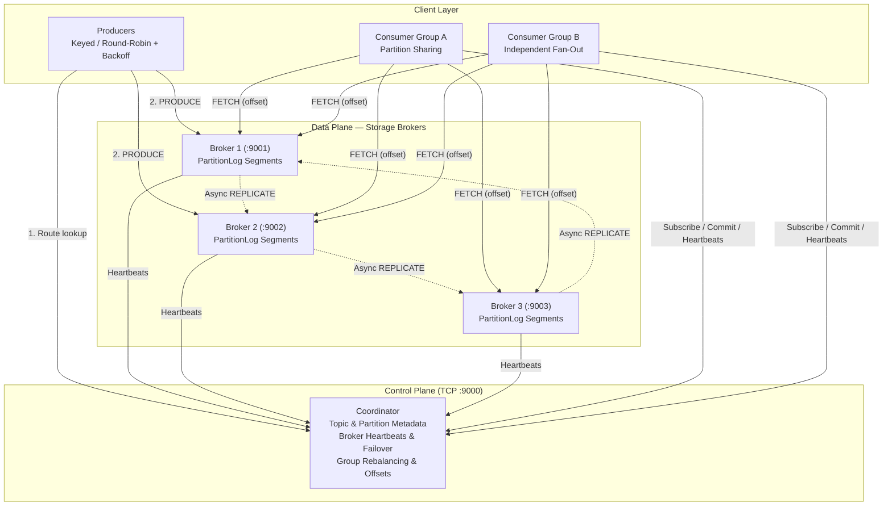
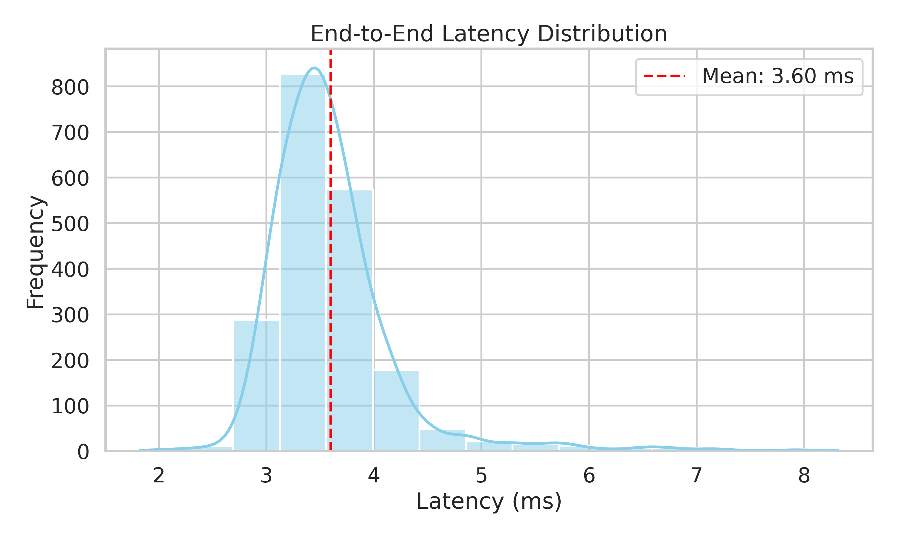
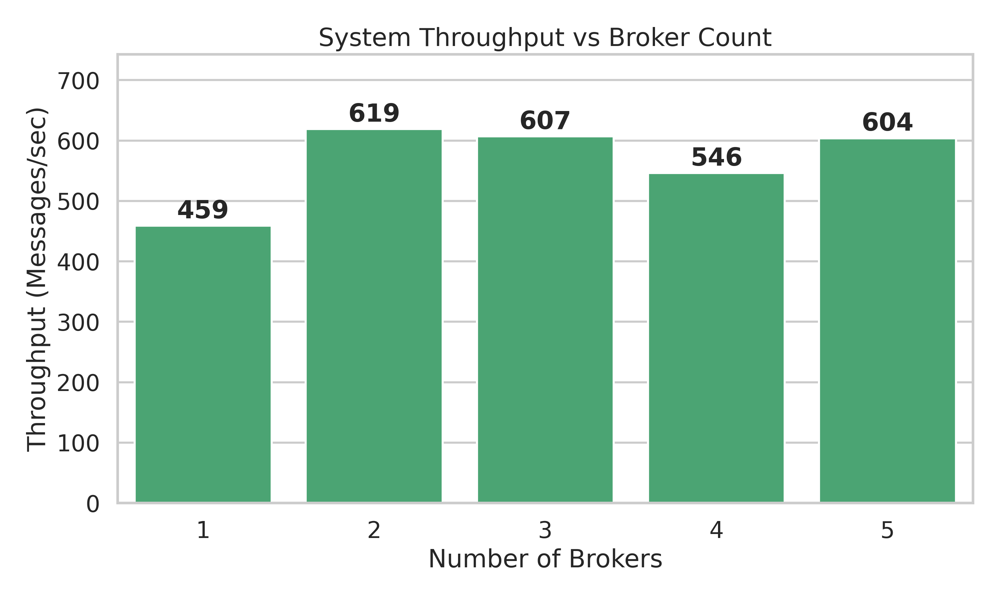
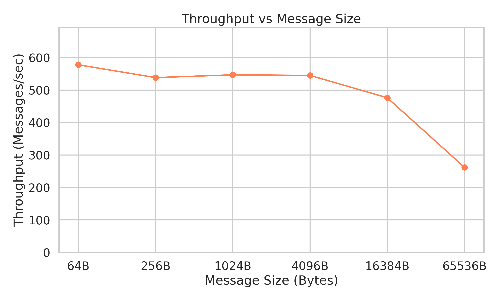
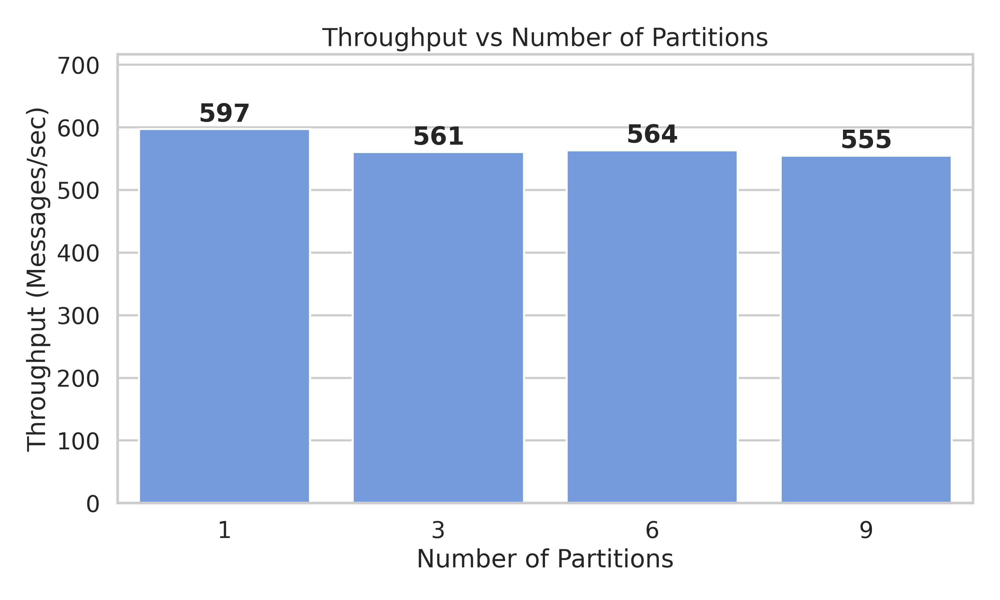

# StreamLog

**A Fault-Tolerant, Kafka-Inspired Distributed Publish-Subscribe Messaging Engine in Pure Python**

*Partitioned topics · Segmented append-only logs · Async primary-replica replication · Consumer groups & fan-out · Automatic broker failover · Zero runtime dependencies*

- [Overview](#overview)
- [Architecture](#architecture)
- [Modular Project Structure](#modular-project-structure)
- [Quick Start](#quick-start)
- [Client API](#client-api)
- [Wire Protocol & Storage Internals](#wire-protocol--storage-internals)
- [Benchmarks & Performance](#benchmarks--performance)
- [Testing](#testing)
- [Configuration](#configuration)
- [Design Decisions & Roadmap](#design-decisions--roadmap)
- [Author & License](#author--license)

---

## Overview

**StreamLog** is a lightweight, modular distributed event-streaming and publish-subscribe messaging engine built from scratch using only the Python standard library. Modeled on Apache Kafka's core architecture, it separates cluster coordination from partitioned log storage and provides clean, thread-safe Producer and Consumer APIs over a custom length-prefixed TCP wire protocol.

### Key Capabilities

- **Partitioned Topics & Routing** — Supports deterministic key-based hashing (`hash(key) % P`) for strict per-key ordering and round-robin distribution for keyless load balancing.
- **Segmented Append-Only Storage** — Each broker persists partition records in rotated, newline-delimited JSON log segments backed by an in-memory offset index for O(log n) binary-search seeks and crash recovery on restart.
- **Consumer Groups & Broadcast Fan-Out** — Consumers in the same group share partitions exclusively with zero duplicate delivery; independent consumer groups receive the full topic stream with isolated offset tracking.
- **Dynamic Rebalancing & Heartbeats** — Automatically redistributes partitions when consumers join, leave gracefully, or time out via background heartbeat monitoring.
- **Replication & Automatic Failover** — Primary brokers asynchronously replicate writes to replica brokers. When a primary misses heartbeats beyond `BROKER_TIMEOUT`, the coordinator automatically promotes its replica and reroutes producers and consumers.
- **At-Least-Once Delivery** — Explicit offset commits checkpoint consumer progress; uncommitted messages are redelivered after a consumer crash or rebalance.

---

## Architecture



---

## Modular Project Structure

```text
streamlog/
├── streamlog/                     # Core installable Python package (zero runtime deps)
│   ├── __init__.py                # Public API exports (Producer, Consumer, config)
│   ├── config.py                  # Centralized defaults with STREAMLOG_* env overrides
│   ├── common/
│   │   ├── models.py              # Wire message-type constants & ok()/error() helpers
│   │   └── protocol.py            # 4-byte big-endian length-prefixed JSON TCP framing
│   ├── coordinator/
│   │   ├── state.py               # Thread-safe metadata store, rebalancer & replica promoter
│   │   ├── server.py              # TCP request dispatcher & background heartbeat monitor
│   │   └── __main__.py            # CLI entry point (python -m streamlog.coordinator)
│   ├── broker/
│   │   ├── storage.py             # Segmented append-only PartitionLog + O(log n) index
│   │   ├── server.py              # TCP broker server, async replication & heartbeats
│   │   └── __main__.py            # CLI entry point (python -m streamlog.broker)
│   └── client/
│       ├── producer.py            # Thread-safe Producer with routing & exponential backoff
│       └── consumer.py            # Thread-safe Consumer with groups, polling & commits
├── scripts/
│   ├── start_cluster.sh           # Launches 1 Coordinator + 3 Brokers (foreground or --bg)
│   └── stop_cluster.sh            # Gracefully stops a background cluster
├── demo/
│   └── ecommerce_demo.py          # Order service + payment & inventory consumer groups demo
├── benchmark/
│   ├── benchmark.py               # Throughput, latency, payload, partition & broker scaling
│   ├── plot_benchmarks.py         # Matplotlib/Seaborn chart generator
│   └── results/                   # Generated benchmark PNG plots
├── tests/
│   └── test_system.py             # 46 real-process integration tests (25 test classes)
├── docs/
│   └── TEST_CASES.md              # Full specification of all 25 test classes
├── .github/workflows/ci.yml       # Automated GitHub Actions CI (Python 3.10–3.12)
├── Makefile                       # Shortcuts for cluster, demo, tests & benchmarks
├── pyproject.toml                 # PEP 621 package metadata & CLI entry points
└── LICENSE                        # MIT License
```

---

## Quick Start

### 1. Clone & Install

```bash
git clone <your-repo-url>
cd streamlog

# Editable install (core has zero third-party dependencies)
pip install -e .

# Optional: install test & benchmark visualization extras
pip install -e ".[dev,benchmark]"
```

### 2. Start a Local 3-Broker Cluster

```bash
# Foreground (Ctrl-C stops all nodes cleanly)
bash scripts/start_cluster.sh

# Or run in the background
bash scripts/start_cluster.sh --bg
bash scripts/stop_cluster.sh
```

This boots:
- **Coordinator** at `127.0.0.1:9000`
- **Broker 1** at `127.0.0.1:9001`
- **Broker 2** at `127.0.0.1:9002`
- **Broker 3** at `127.0.0.1:9003`

You can also launch individual nodes via installed CLI entry points or module invocations:

```bash
streamlog-coordinator --host 127.0.0.1 --port 9000
streamlog-broker --id broker1 --host 127.0.0.1 --port 9001 --coord-host 127.0.0.1 --coord-port 9000
```

### 3. Run the E-Commerce Demo

With the cluster running in one terminal, launch the demo in another:

```bash
python demo/ecommerce_demo.py
```

The demo publishes 20 keyed e-commerce orders to a 3-partition `orders` topic while two consumer groups run concurrently:
- **`payment-group`** (2 consumers) splits partitions in parallel with zero overlap.
- **`inventory-group`** (1 consumer) independently receives all 20 orders (fan-out).

---

## Client API

### Producer

```python
from streamlog import Producer

producer = Producer("127.0.0.1", 9000)
producer.create_topic("orders", num_partitions=3)

# Keyless -> round-robin across partitions
offset = producer.send("orders", "order_id=ORD-1001")

# Keyed -> deterministic hash routing (strict per-key ordering)
offset = producer.send("orders", "order_id=ORD-1002", key="user-42")
```

### Consumer

```python
from streamlog import Consumer

with Consumer("127.0.0.1", 9000, consumer_id="worker-1") as consumer:
    consumer.subscribe("orders", group_id="payment-group")

    while True:
        records = consumer.poll(timeout_ms=1000)
        for rec in records:
            print(f"[p={rec['partition']} @{rec['offset']}] {rec['message']}")
            consumer.commit(rec["partition"], rec["offset"] + 1)
```

---

## Wire Protocol & Storage Internals

### Framing Protocol (`streamlog/common/protocol.py`)

Every TCP message uses a 4-byte big-endian unsigned integer length prefix followed by a UTF-8 JSON payload:

```text
+---------------------------+----------------------------------------+
|  Payload Length (4 bytes) |       UTF-8 JSON Payload (N bytes)     |
|  Big-Endian uint32 (>I)   |  {"type": "PRODUCE", "topic": ...}     |
+---------------------------+----------------------------------------+
```

### Segmented Partition Logs (`streamlog/broker/storage.py`)

- Records are appended as newline-delimited JSON (`{"offset", "key", "message", "ts"}`) to `<data_dir>/broker_<id>/<topic>_<partition>.log`.
- When a segment exceeds `SEGMENT_SIZE_BYTES` (default `1 MiB`), a new numbered segment (`.log.1`, `.log.2`, ...) is rotated automatically.
- An in-memory offset index `[(offset, segment_idx, byte_pos), ...]` enables O(log n) binary-search seeks and is rebuilt automatically on broker startup, safely stopping at any truncated trailing entry.

---

## Benchmarks & Performance

Measured locally on a 3-broker cluster using `benchmark/benchmark.py` and `benchmark/plot_benchmarks.py`:

| Benchmark | Measured Result | Notes |
|---|---|---|
| **End-to-End Latency** | **3.60 ms mean** | Tight unimodal distribution (~2.8–4.5 ms) across 2,000 samples |
| **Broker Horizontal Scaling** | **459 -> 619 msg/s** | +35% throughput gain from 1 to 2 brokers; ~600+ msg/s up to 5 brokers |
| **Payload Scalability** | **~578 -> ~262 msg/s** | 64 B to 64 KB payloads (higher raw byte throughput at larger sizes) |
| **Partition Scaling** | **555 – 597 msg/s** | Consistent single-producer throughput across 1, 3, 6, and 9 partitions |

### End-to-End Latency Distribution


### Horizontal Scalability (1 to 5 Brokers)


### Payload Scalability (64 B to 64 KB)


### Partition Scaling (1 to 9 Partitions)


To reproduce benchmarks and regenerate charts:

```bash
# Ensure the cluster is running: bash scripts/start_cluster.sh
python benchmark/benchmark.py --scale-brokers
python benchmark/plot_benchmarks.py
```

---

## Testing

StreamLog includes **46 end-to-end integration tests** across **25 test classes** (`tests/test_system.py`) that spin up real OS processes (coordinator + brokers) on isolated high ports (`19000–19004`) over actual TCP sockets — no mocks.

```bash
# Fast suite (42 tests — core, partitioning, groups, offsets, concurrency, replication)
make test-fast

# Fault-tolerance suite (TC19–TC22 — broker crashes, replica promotion, consumer eviction)
make test-fault

# Complete 46-test suite
make test
```

See [docs/TEST_CASES.md](docs/TEST_CASES.md) for the complete specification of all 25 test classes.

GitHub Actions automatically runs both the fast integration matrix (Python 3.10, 3.11, 3.12) and the fault-tolerance failover suite on every push and pull request.

---

## Configuration

All defaults live in [`streamlog/config.py`](streamlog/config.py) and can be overridden via environment variables:

| Setting | Env Variable | Default | Description |
|---|---|---|---|
| `COORDINATOR_HOST` | `STREAMLOG_COORDINATOR_HOST` | `127.0.0.1` | Coordinator bind/connect host |
| `COORDINATOR_PORT` | `STREAMLOG_COORDINATOR_PORT` | `9000` | Coordinator TCP port |
| `BROKER_BASE_PORT` | `STREAMLOG_BROKER_BASE_PORT` | `9001` | Base port for broker nodes |
| `DATA_DIR` | `STREAMLOG_DATA_DIR` | `data` | Root directory for partition logs |
| `SEGMENT_SIZE_BYTES` | `STREAMLOG_SEGMENT_SIZE_BYTES` | `1048576` | Segment rotation threshold (1 MiB) |
| `BROKER_HEARTBEAT_INTERVAL` | `STREAMLOG_BROKER_HEARTBEAT_INTERVAL` | `3` | Seconds between broker heartbeats |
| `BROKER_TIMEOUT` | `STREAMLOG_BROKER_TIMEOUT` | `10` | Seconds before broker failover |
| `CONSUMER_HEARTBEAT_INTERVAL` | `STREAMLOG_CONSUMER_HEARTBEAT_INTERVAL` | `5` | Seconds between consumer heartbeats |
| `CONSUMER_TIMEOUT` | `STREAMLOG_CONSUMER_TIMEOUT` | `15` | Seconds before consumer eviction |
| `PRODUCER_MAX_RETRIES` | `STREAMLOG_PRODUCER_MAX_RETRIES` | `5` | Max retries on transient send failures |
| `PRODUCER_RETRY_BASE_S` | `STREAMLOG_PRODUCER_RETRY_BASE_S` | `0.2` | Initial exponential backoff delay (s) |
| `CONSUMER_MAX_POLL_RECORDS` | `STREAMLOG_CONSUMER_MAX_POLL_RECORDS` | `100` | Max records returned per partition poll |

---

## Design Decisions & Roadmap

| Component | Design Choice | Rationale |
|---|---|---|
| Wire Protocol | 4-byte length-prefixed JSON | Human-readable, zero external dependencies, supports arbitrary payload sizes |
| Concurrency | Thread-per-connection + locks | Simple, predictable concurrency model using Python stdlib sockets |
| Storage | Segmented append-only NDJSON + in-memory index | Durable across restarts with O(log n) offset seeks |
| Rebalancing | Deterministic range/modulo assignment | Balanced partition distribution across sorted group members |
| Replication | Async fire-and-forget primary -> replica | Maximizes write throughput while maintaining warm failover replicas |

**Planned Enhancements:** Coordinator Raft/leader election (removing single point of failure), log compaction, persistent offset storage on disk, TLS transport encryption, and topic deletion.

---

## Author & License

**Rajath Gadagkar** — rajathgadagkar@gmail.com

Distributed under the **MIT License**. See [LICENSE](LICENSE) for details.
